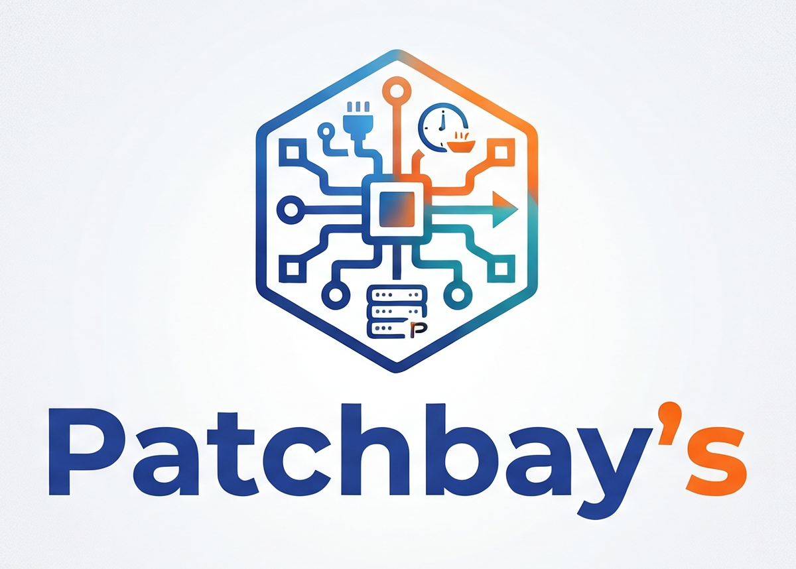
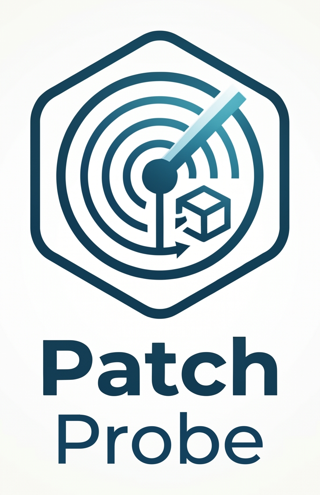
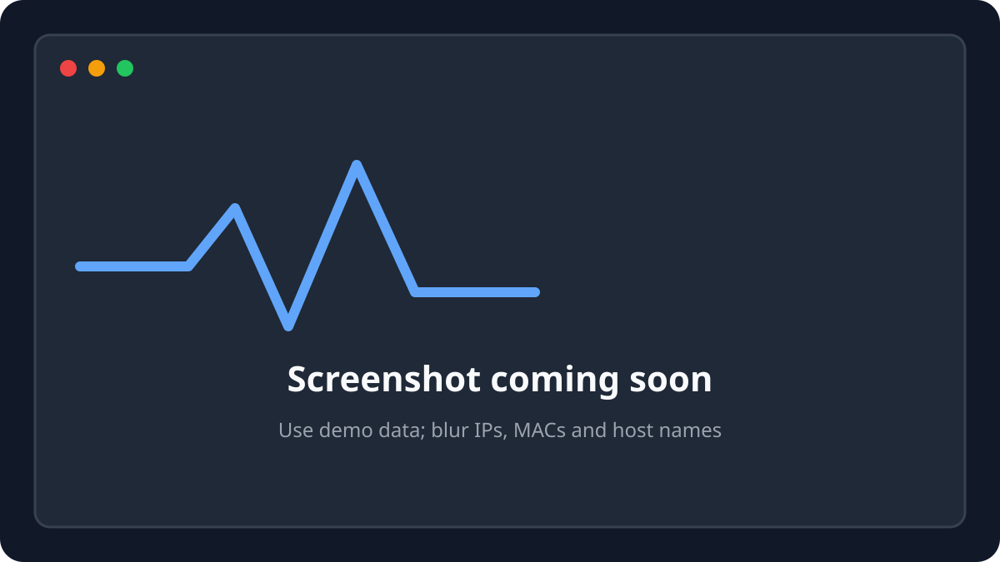

<p align="center">
  
</p>

<p align="center">
  
</p>

<h1 align="center">PatchProbe</h1>

<p align="center"><b>PatchProbe was formerly known as IPScanner.</b></p>

<p align="center"><b>A fast, private network scanner for macOS, Windows and Linux.</b></p>

<p align="center">
PatchProbe finds the devices on your local network, shows their open ports, names, MAC
addresses and vendors, and lets you dig into any host with nmap, UDP, SNMP and traceroute.
Everything runs locally: no account, no cloud, no telemetry.
</p>

<p align="center">
  <a href="#license"></a>
  <a href="https://github.com/Patchbay-s/PatchProbe/releases"></a>
  
  
  
  <a href="#status"></a>
</p>

<br>

<p align="center">
  
</p>
<p align="center"><sub>The main window after a scan of a demo network: live results table, filters and grouping, and the detail panel of a host.</sub></p>

<br>

<p align="center">
  <a href="#host-discovery">Discovery</a> ·
  <a href="#name-resolution">Names</a> ·
  <a href="#mac-addresses-and-vendors">Vendors</a> ·
  <a href="#port-scanning">Ports</a> ·
  <a href="#host-tools">Host tools</a> ·
  <a href="#history-and-site-profiles">History</a> ·
  <a href="#export">Export</a> ·
  <a href="#downloads">Downloads</a> ·
  <a href="#build-from-source">Build</a> ·
  <a href="#architecture">Architecture</a> ·
  <a href="#status">Status</a>
</p>

<br>

## Host discovery

<p align="center"></p>
<p align="center"><sub>Rows appear as hosts answer; unreachable addresses can be hidden.</sub></p>

- Scan a **CIDR block** (`192.0.2.0/24`), a **range** (`192.0.2.1-192.0.2.254` or `192.0.2.1-254`)
  or a **single address**, up to a /16 (65,536 addresses). The local network is detected
  automatically, and the last five ranges are remembered.
- **Ping and TCP scan run in parallel** for every host: an open port or a TCP connection refusal
  proves a host is there even when it ignores ping and has no scanned service listening.
- An **end-of-scan ARP sweep** promotes silent devices that the ARP table proves are present, and
  re-pings live hosts whose MAC address is still unknown.
- **One global cap on simultaneous TCP connections** (256 by default) shared by all hosts and
  ports, a cap on hosts scanned in parallel, and automatic back-off when the OS runs out of
  sockets or buffers.
- **Rapide / Approfondi** timing presets, every timeout and limit adjustable in the settings.
- Results stream into the table live; a scan can be stopped at any time and starting a new one
  cancels the previous one, child processes included.
- **Probable OS** and **routed host** detection from the ping TTL, and a device-type icon
  (router, camera, printer, NAS, phone, media, IoT…).
- Sortable, virtualized table with live search (IP, name, vendor, MAC, OS, port), grouping by
  subnet, vendor or status, and per-row actions: re-ping, open in the browser, details.

## Name resolution

<p align="center"></p>
<p align="center"><sub>The name diagnostic shows exactly what each technique answered, and how long it took.</sub></p>

- Nine independent techniques run for every live host: reverse DNS (PTR), **direct query to the
  router's DNS** (finds DHCP client names that the system resolver misses), mDNS, NetBIOS (NBNS),
  SMB2/NTLMSSP pre-authentication, LLMNR, SNMP `sysName` and the **HTML title** of web services.
- **Bonjour** and **SSDP/UPnP** browsing at the end of the scan for devices that never answer a
  direct query.
- Every technique returns a typed result (*found*, *no name* with the reason, *timeout*, *error*,
  *skipped*). The **name diagnostic** panel shows the full trace for a host and can re-run every
  technique on demand.
- **Default name source** setting: the HTML title of web services is shown first by default
  (best for self-hosted services); pick any other technique, or the automatic order, in Settings.
- A per-IP cache keeps found names for 7 days; failures are only remembered for 5 minutes.
- All protocol decoders are hand-written, bounds-checked and tested against truncated and corrupted packets.

## MAC addresses and vendors

<p align="center"></p>
<p align="center"><sub>Grouping by vendor, with a manual correction on one device.</sub></p>

- MAC addresses from the system neighbor table (`arp -an` on macOS, `ip neigh` / `/proc/net/arp`
  on Linux, `arp -a` on Windows, any language).
- Vendor lookup in the **embedded IEEE OUI registry** (about 39,000 entries), offline.
- **Manual vendor correction per MAC address**, to relabel a device or fix a randomized MAC.
- **Wake-on-LAN** magic packet from the host details.
- On **macOS 27**, the system only shows the neighbor table to notarized apps: use the signed
  release (or a Developer ID build). The Mac App Store edition is sandboxed and shows no MAC
  addresses or vendors.

## Port scanning

<p align="center"></p>
<p align="center"><sub>Port presets per device type; the field stays editable.</sub></p>

- TCP connect scan, no administrator rights needed.
- Default list oriented towards classic services and self-hosted/homelab apps; custom single
  ports, ranges and comma-separated lists (`22,80,443,8000-8010`), up to 5,000 ports, with
  explicit errors.
- Presets per device type: IP camera, generic/homelab, web server, printer, NAS.
- Open a host in the browser over http or https, or on any of its open ports.

## Host tools

<p align="center"></p>
<p align="center"><sub>Service detection with nmap, UDP probes and the route to the host.</sub></p>

- **nmap integration (optional)**: `-Pn -sV` service detection with the XML output parsed into a
  table; cancellable, with a clear message and install hint when nmap is missing.
- **UDP scan** of common services (DNS, DHCP, TFTP, NTP, NetBIOS, SNMP, ISAKMP, SSDP, mDNS) with
  real *open / closed / open|filtered* states.
- **SNMP system walk**: description, uptime, contact, name, location, number of interfaces.
- **Traceroute** (`traceroute`, `tracepath` or `tracert`), hop by hop.
- **Favorites and free notes** per IP address.

## History and site profiles

<p align="center"></p>
<p align="center"><sub>What changed between two scans of the same network.</sub></p>

- Every finished scan is saved locally; reload a past scan without touching the network.
- **Compare two scans**: hosts that appeared, disappeared or changed (name, MAC, vendor, ports).
- **Site profiles**: the expected inventory of a site (label, IP and/or MAC), created in one
  click from the current results and editable.

<p align="center"></p>
<p align="center"><sub>Comparing a site profile with the current scan.</sub></p>

- **Compare to profile** matches on MAC first (DHCP changes IPs, not MACs) and sorts devices into
  *missing*, *unexpected*, *IP mismatch* and *matching*.

## Export

<p align="center"></p>
<p align="center"><sub>Exporting the results to a standalone HTML report.</sub></p>

- **CSV** (spreadsheet formula injection neutralized), **JSON** and a standalone **HTML** report
  (fully escaped).
- Data files are plain JSON in your user data directory, written atomically; a corrupted file is
  set aside, never overwritten.

## Downloads

> **Version 1.0.0.** The macOS build is for **Apple silicon**, signed with an Apple Developer ID
> and notarized. Intel, Windows and Linux packages are coming soon; until then,
> [build from source](#build-from-source).

### macOS

| Build | File | Notes |
|---|---|---|
| App, Apple silicon (arm64) | [`PatchProbe_1.0.0_macos-aarch64.dmg`](https://github.com/Patchbay-s/PatchProbe/releases/download/v1.0.0/PatchProbe_1.0.0_macos-aarch64.dmg) | Signed and notarized, all features |
| Mac App Store | Coming soon | Sandboxed edition: no MAC addresses, vendors, traceroute or nmap |
| App, universal (Apple silicon + Intel) | `PatchProbe_<ver>_universal.dmg` | Coming soon |

#### Install with Homebrew

```bash
brew tap Patchbay-s/patchprobe
brew install --cask patchprobe
```

Verify the download against [`SHA256SUMS.txt`](https://github.com/Patchbay-s/PatchProbe/releases/download/v1.0.0/SHA256SUMS.txt).

### Windows

| Build | Installer | Portable |
|---|---|---|
| x64 (64-bit Intel/AMD) | `patchprobe-<ver>-windows-x64.msi` — coming soon | `patchprobe-<ver>-windows-x64-portable.zip` — coming soon |
| arm64 | `patchprobe-<ver>-windows-arm64.msi` — coming soon | `patchprobe-<ver>-windows-arm64-portable.zip` — coming soon |

### Linux

| Format | x86_64 | aarch64 (ARM64) |
|---|---|---|
| AppImage | `patchprobe-<ver>-linux-x86_64.AppImage` — coming soon | `patchprobe-<ver>-linux-aarch64.AppImage` — coming soon |
| Debian/Ubuntu | `patchprobe-<ver>-linux-x86_64.deb` — coming soon | `patchprobe-<ver>-linux-aarch64.deb` — coming soon |
| Fedora/RHEL/openSUSE | `patchprobe-<ver>-linux-x86_64.rpm` — coming soon | `patchprobe-<ver>-linux-aarch64.rpm` — coming soon |

**nmap** is never bundled. Install it separately if you want service detection.

## Build from source

Prerequisites: Rust (stable, via [rustup](https://rustup.rs)), Node.js 20+, and the
[Tauri 2 system dependencies](https://v2.tauri.app/start/prerequisites/). On Debian/Ubuntu:

```bash
sudo apt-get install -y libwebkit2gtk-4.1-dev libgtk-3-dev libayatana-appindicator3-dev \
  librsvg2-dev build-essential libssl-dev patchelf
```

Then:

```bash
git clone https://github.com/Patchbay-s/PatchProbe.git
cd PatchProbe/rust/app
npm ci
npm run tauri dev      # run in development mode
npm run tauri build    # build an app bundle/installer for your OS (not notarized)
```

Run the checks:

```bash
cd PatchProbe/rust/app && npm run build   # the front-end must be built once before cargo build
cd ..                                    # PatchProbe/rust
cargo fmt --all --check
cargo clippy --workspace --all-targets -- -D warnings
cargo test --workspace
```

See [CONTRIBUTING.md](CONTRIBUTING.md) for per-OS details and the permissions a scan needs, and
[`.env.example`](.env.example) for the variables used by signed builds.

## Architecture

| Layer | Path | Role |
|---|---|---|
| Core (pure Rust) | [`rust/crates/patchprobe-core`](rust/crates/patchprobe-core) | Ranges and ports, models, scan engine (tokio), name resolution techniques, protocol codecs (DNS, NBNS, SNMP/BER, SMB2/NTLMSSP, SSDP, HTTP title), parsers for `ping`/`arp`/`route`/`traceroute`/nmap XML output, OUI registry, diffs, JSON storage, exports. No UI and no OS-specific code. |
| Platform | [`rust/crates/patchprobe-platform`](rust/crates/patchprobe-platform) | The OS-specific parts behind a `Platform` trait: interfaces and default gateway, system `ping`, neighbor table, nmap/traceroute subprocesses (array arguments, killed on cancel), opening URLs, user data directory. |
| Tauri commands | [`rust/app/src-tauri`](rust/app/src-tauri) | Tauri 2 commands and events: scan orchestration with batched live updates, host tools, history, site profiles, settings, export. |
| Front-end | [`rust/app/src`](rust/app/src) | React + TypeScript + Vite user interface (in French). |
| Legacy app | Not included | The original macOS-only Swift/SwiftUI app is preserved only in the private historical repository; see [`rust/PORTING.md`](rust/PORTING.md) for the migration overview. |

[`rust/PORTING.md`](rust/PORTING.md) maps every Swift file to its Rust module.

## Status

Current version: **1.0.0**, [released](https://github.com/Patchbay-s/PatchProbe/releases/tag/v1.0.0) for
Apple silicon (signed and notarized). Follow the
[releases page](https://github.com/Patchbay-s/PatchProbe/releases) for updates. What works today:

- Everything described above is implemented in the Rust/Tauri app and covered by about 200
  automated tests (parsers and protocol decoders fed with fixtures from all three OS, network
  techniques against loopback test servers, engine concurrency and cancellation).
- CI builds, lints and tests the workspace on macOS, Windows and Linux.

What is missing or known to be rough:

- **Apple silicon only** for now, and no auto-update.
- The app has **not yet been field-tested by users on many real networks**; please report what
  you see, the name diagnostic panel output is especially useful.
- Features of the legacy Swift app **not ported yet**: reading and changing the IP configuration
  (DHCP/static), saved static IP profiles, and the menu bar icon. Keyboard shortcuts are not
  ported either.
- **IPv4 only.** SNMP uses v1 with the `public` community only.
- The user interface is **French only** for now.
- Name resolution coverage depends heavily on the network: the legacy app found few names on
  some networks without a known cause, which is what the per-technique diagnostic is meant to
  explain.
- Platform notes: on **macOS**, if a scan finds no hosts, check that PatchProbe is allowed under
  **System Settings › Privacy & Security › Local Network**; see the
  [permission instructions](CONTRIBUTING.md#permissions-needed-to-scan). On **Linux**,
  unprivileged `ping` must be allowed; on **Windows**, the firewall may drop some replies
  (NetBIOS, SSDP, SNMP) until the app is allowed through.

## The Patchbay's apps

Patchbay is a small family of free, independent apps made by an audiovisual technician for the
people who work backstage and those who keep their lab running.

| | App | What it's for | Links |
|---|---|---|---|
|  | **PatchProbe** | Fast network scanner for macOS, Windows & Linux | *you are here* |
|  | **PatchTime** | Overtime and work summaries | [Code](https://github.com/Patchbay-s/PatchTime) |
|  | **PatchNode** | iPhone, iPad & Mac dashboard for your homelab | [Code](https://github.com/Patchbay-s/PatchNode) |

## Responsible use

PatchProbe actively probes the machines of the range you give it. **Only scan networks you own or
are explicitly authorized to scan.** Scanning other people's networks can be illegal and can
trigger intrusion-detection systems. When sharing logs or screenshots, blur IP addresses, MAC
addresses and device names.

## License

PatchProbe is free software, released under the [GNU General Public License v3.0](LICENSE)
(`GPL-3.0-only`). The name, icon and brand assets are **not** covered by the GPL: forks must
rename the app, change its icon and its application identifier before distributing it, see
[TRADEMARKS.md](TRADEMARKS.md).

Third-party components:

- [Tauri](https://tauri.app) (MIT or Apache-2.0), [tokio](https://tokio.rs) (MIT),
  [reqwest](https://github.com/seanmonstar/reqwest) and [rustls](https://github.com/rustls/rustls)
  (Apache-2.0, ISC or MIT), [mdns-sd](https://github.com/keepsimple1/mdns-sd) (Apache-2.0 or
  MIT), [quick-xml](https://github.com/tafia/quick-xml) (MIT), [if-addrs](https://github.com/messense/if-addrs)
  (MIT or BSD-3-Clause), [React](https://react.dev) (MIT) and their dependencies.
- All Rust dependencies are checked with [`cargo deny`](https://github.com/EmbarkStudios/cargo-deny)
  against the policy in [`rust/deny.toml`](rust/deny.toml): MIT, Apache-2.0, BSD, ISC, Zlib,
  Unicode-3.0, MPL-2.0 (pulled in by Tauri's HTML tooling), CDLA-Permissive-2.0 (Mozilla CA
  bundle data in `webpki-roots`) and similar permissive licenses, all compatible with GPL-3.0.
- Vendor names come from the public [IEEE OUI registry](https://standards-oui.ieee.org/), embedded
  as data.
- [nmap](https://nmap.org) is an optional external program, not distributed with PatchProbe; it has
  its own license.
